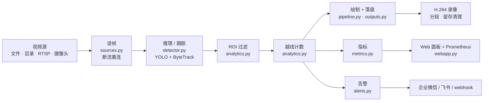

# YOLO 视频 / 摄像头目标检测应用

基于 **Ultralytics YOLO11 + OpenCV** 的可落地工程：同一条链路支持**本地视频、目录批量、RTSP 流、摄像头**，内置跟踪、ROI、越线计数、告警抓拍、Web 面板与 Prometheus 指标，可 Docker 部署、可自有数据微调。

[](https://github.com/GUIDchen/yolo-video-detect/actions/workflows/ci.yml)
[](LICENSE)
[](pyproject.toml)

> 一个可以照抄的工程骨架：不只演示"怎么检测"，而是把断流重连、越线计数、告警、指标、分段留存、Docker 部署与 CI 都接通。

## 能力清单

| 能力 | 入口 |
| --- | --- |
| 多源输入（文件/目录/RTSP/摄像头） | `python -m yolo_app run --source ...` |
| 摄像头实时检测与录像 | `python -m yolo_app camera` |
| 多路多进程并发 | `run --workers 4`（目录批量） |
| 目标跟踪（ByteTrack/BoT-SORT） | `--track` |
| ROI 区域过滤 | `--roi "x,y x,y ..."` |
| 越线计数（按 track_id 判定穿越方向） | `--line "x1,y1,x2,y2" --count-classes person` |
| 告警抓拍 + webhook 推送 | `--alert-webhook <key或URL> --alert-type wecom` |
| Web 面板（MJPEG + WebSocket + Prometheus） | `python -m yolo_app serve` |
| 面板鉴权 / 健康检查 / 优雅停机 | `serve --token` · `/healthz` · SIGTERM 自动收尾 |
| 越线防抖 + 轨迹回收 | `analytics.min_cross_frames` / `analytics.track_ttl` |
| 双阈值（低分框只送跟踪） | `--report-conf 0.5` |
| 运动门控（没动不推理） | `motion.enable: true` |
| ROI 裁剪推理（快 1.8×） | `analytics.roi_crop: true` + `roi_imgsz: 320` |
| 直播源 FFmpeg 后端 + 僵死看门狗 | `run.reader: auto` / `run.read_timeout: 10` |
| 录像分段 / 留存清理 | `--segment-seconds 300 --keep-days 7 --max-files 200` |
| 模型管理（清单/下载/对照切换） | `python -m yolo_app models [--download ...] [--benchmark]` |
| 模型导出（ONNX/TensorRT/OpenVINO…） | `python -m yolo_app export --format onnx` |
| Docker 部署（headless） | `docker compose up -d` |
| 自有数据微调 | `python scripts/train.py --data ...` |
| CI | `.github/workflows/ci.yml` |

## 流水线架构



扩展原则：加输入改 `sources.py`，加后处理改 `analytics.py` + pipeline 里一行，加输出改 `outputs.py`，加接口改 `webapp.py`——不在主循环里堆业务分支。

## 目录结构

```
yolo-video-detect/
├── yolo_app/                 # 应用包（python -m yolo_app 直接运行，无需安装）
│   ├── __main__.py           # 模块入口
│   ├── cli.py                # 子命令：run / camera / check / export / serve
│   ├── config.py             # 配置三层合并：默认值 ← YAML ← 命令行
│   ├── detector.py           # 模型封装：权重定位、类别解析、推理/跟踪
│   ├── sources.py            # 视频源：文件/目录/摄像头/RTSP + 断流重连
│   ├── pipeline.py           # 主循环：读帧→推理→ROI→越线→绘制→落盘→统计→告警
│   ├── analytics.py          # ROI 多边形过滤 + 越线计数
│   ├── alerts.py             # 告警通道：企业微信/飞书/通用 webhook
│   ├── outputs.py            # 视频写入（H.264/分段）、事件抓拍、留存清理、JSON
│   ├── models.py             # 模型清单/下载/基准对照（models 子命令）
│   ├── metrics.py            # Prometheus 文本指标
│   ├── webapp.py             # Web 面板：MJPEG 流 + WebSocket + /metrics
│   └── logging_setup.py      # 日志
├── configs/
│   ├── default.yaml          # 运行配置（复制成 production.yaml 多环境）
│   └── dataset.yaml          # 自有数据集模板
├── scripts/
│   ├── get_weights.sh        # 网络受限时用镜像拉权重
│   ├── make_test_video.py    # 生成测试视频
│   └── train.py              # 自有数据微调
├── tests/test_smoke.py       # 冒烟测试（16 个用例，含真模型端到端）
├── docs/ARCHITECTURE.md      # ★ 架构与代码说明：模块职责、数据流、扩展点、部署形态
├── docs/CODE_WALKTHROUGH.md  # ★ 逐行代码详解：每个主模块每行在干什么、为什么
├── deploy/                   # 部署模板：systemd unit + 上线检查清单
├── .github/workflows/ci.yml  # CI：ruff + 自检 + 单测 + 端到端
├── .vscode/                  # F5 运行配置（6 个）
├── Dockerfile / docker-compose.yml / .dockerignore
├── Makefile                  # make check/test/run/serve/export/docker-*/install-src
├── pyproject.toml            # ruff 配置
├── .gitignore                # 忽略 .venv / outputs / datasets / 权重
├── detect_video.py           # 旧入口兼容壳
└── data/  weights/  outputs/  datasets/
```

> 想知道"每个文件到底干什么、一帧数据怎么流动、要加功能该改哪里"，看 [docs/ARCHITECTURE.md](docs/ARCHITECTURE.md)；
> 想**逐行**读懂代码（每行在做什么、为什么这么写、删掉会怎样），看 [docs/CODE_WALKTHROUGH.md](docs/CODE_WALKTHROUGH.md)。
> 每个 Python 模块头部也有详细的职责说明与扩展点注解。
> 想知道**还能怎么改、为什么这么改**（对照 Frigate / supervision 等标杆的差距分析、P1/P2 路线与验收标准），
> 看 [docs/OPTIMIZATION.md](docs/OPTIMIZATION.md)。

## 安装

```bash
git clone <repo> && cd yolo-video-detect     # 或直接拷贝目录
make install                                 # 等价于下面的手工步骤（make help 看全部命令）
```

手工步骤：

```bash
cd yolo-video-detect
python3.12 -m venv .venv          # 3.10-3.13
source .venv/bin/activate
pip install -r requirements.txt   # 国内慢/不通：-i https://mirrors.aliyun.com/pypi/simple/
bash scripts/get_weights.sh       # 拉取 weights/yolo11n.pt
export YOLO_OFFLINE=true
```

> `uvicorn[standard]` 里的 websockets 是 WebSocket 推送的硬依赖；只装裸 uvicorn 时 `/ws` 会静默 404（程序启动时会给出提示）。

## 快速开始

```bash
python -m yolo_app check                                          # 环境自检
python -m yolo_app run --source data/test.mp4 --track             # 视频检测 + 跟踪
python -m yolo_app camera --index 0                               # 摄像头实时（按 q 退出）
python -m yolo_app camera --record --no-show --max-frames 300     # 摄像头后台录像
python -m yolo_app run --source data/ --workers 4                 # 目录批量 + 多进程
python -m yolo_app serve --source 0                               # Web 面板 http://127.0.0.1:8000
python -m yolo_app export --format onnx                           # 导出部署格式
```

## 运行效果

本机实测输出（Apple Silicon CPU，`ultralytics 8.4.152` / `torch 2.14.0`）：

```console
$ python -m yolo_app check
[INFO] 模型 weights/yolo11n.pt | 类别数 80 | 设备 cpu | 跟踪 False | 类别过滤 全部
[INFO] 自检通过 ✅

$ python -m yolo_app run --source data/test.mp4 --track --max-frames 5 --out-dir /tmp/out
[INFO] 开始处理 data/test.mp4 | 640x480 @25fps | 设备 cpu | 跟踪 bytetrack.yaml
[INFO] 完成 data/test.mp4 | 推理 5 帧 | 4.9 FPS | 唯一目标 4 | 越线 in 0/out 0 | 事件 1 | 输出 /tmp/out/test.mp4
```

- `唯一目标` 依赖跟踪 ID 去重，**未开启 `--track` 时不计入**，要让这个数字有意义请加 `--track`。
- FPS 随硬件、`--imgsz`、是否跟踪而变；多模型横向对照见下文「切换其他 YOLO 模型」的实测表。
- 输出视频、抓拍与 JSON 落在 `--out-dir`（默认 `outputs/`），该目录不入库。

## 命令行参考

### 子命令
| 子命令 | 作用 |
| --- | --- |
| `run --source` | 检测视频文件 / 目录（批量）/ RTSP 地址 |
| `camera` | 摄像头实时检测（`--index/--width/--height/--fps/--record/--no-show`） |
| `check` | 环境与模型自检 |
| `export --format` | 导出 onnx / engine / openvino / torchscript / coreml |
| `serve` | Web 面板（`--host/--port/--quality/--token`） |

### 通用参数
`--config`、`--model`、`--imgsz`、`--conf`、`--iou`、`--device`、`--classes`、
`--track`、`--stride`、`--max-frames`、`--out-dir`、`--no-video`、`--half`、`--log-level`、`--metrics-file`

### 业务与运维参数
| 参数 | 说明 |
| --- | --- |
| `--roi "x,y x,y ..."` | ROI 多边形，只统计区域内目标（也支持 `x1,y1,x2,y2` 写法） |
| `--line "x1,y1,x2,y2"` | 越线计数线，需配合 `--track` |
| `--count-classes` | 参与越线计数的类别（id 或名称） |
| `--alert-webhook` / `--alert-type` | 告警推送：wecom / feishu / generic |
| `--segment-seconds` | 录像分段秒数 |
| `--keep-days` / `--max-files` | 输出留存清理 |
| `--workers` | 目录批量的并行进程数 |
| `--token` | `serve` 面板访问 token；设置后 /stats /metrics /stream /ws 需带 `?token=` |
| `--report-conf` | 双阈值：低于该值的框只送跟踪，不进统计/绘制/抓拍（默认沿用 `--conf`） |

## 业务后处理：ROI 与越线计数

```bash
# 只统计画面中间区域、并统计人从左到右穿过 x=120 的次数
python -m yolo_app run --source data/test.mp4 --track \
  --roi "60,60 620,60 620,460 60,460" \
  --line "120,0,120,480" --count-classes person
```

- ROI 用中心点射线法判定，框中心在多边形内才保留；ROI 与线都会画在结果视频上。
- 越线方向约定：线由 p1→p2，逆时针侧为 +、顺时针侧为 −；**− 侧穿到 + 侧记为 in**（水平线左→右时，自上而下为 in）。
- 计数按 `track_id` 跨帧判定，**必须开 `--track`**；结果写进 JSON 的 `line_total` / `line_by_class` / `crossings`。
- 默认开防抖：目标要在新的一侧连续 2 帧（`analytics.min_cross_frames`）才计一次，框中心在线附近抖动不会刷计数；
  轨迹超过 `analytics.track_ttl` 帧未再出现即回收，长时间直播不会内存膨胀。

## 告警通道

```bash
python -m yolo_app camera --track --alert-webhook <企业微信机器人key> --alert-type wecom
python -m yolo_app run --source data/ --alert-webhook https://your.host/hook --alert-type generic
```

- 触发条件：抓拍到命中 `output.events.classes` 且置信度 ≥ `min_conf` 的目标（`configs/default.yaml` 可调），或发生越线。
- 抓拍图落在 `outputs/events/`，webhook 收到文本 + 图片路径；发送失败只记日志，不中断检测。
- 企业微信/飞书只传文本（图片推送需要各自的上传接口，未实现——见路线图）。

## Web 面板

```bash
python -m yolo_app serve --source 0 --host 0.0.0.0 --port 8000
```

| 路径 | 内容 |
| --- | --- |
| `/` | 面板页：实时画面 + 统计表 |
| `/stream` | MJPEG 流（可直接嵌到别的前端） |
| `/stats` | 当前统计 JSON |
| `/ws` | WebSocket，每秒推送一次统计 |
| `/metrics` | Prometheus 指标（也支持 `--metrics-file` 落盘给 node_exporter/textfile） |

## 多进程、分段与留存

```bash
# 4 路并行处理目录，录像每 5 分钟切一个文件，只保留最近 7 天、最多 200 个文件
python -m yolo_app run --source /path/videos --workers 4 \
  --segment-seconds 300 --keep-days 7 --max-files 200
```

- 多进程为**一源一进程**，各自独立加载模型；`--workers > 1` 时自动关闭预览窗口（GUI 只能在主进程）。
- 分段产物：`xxx.mp4`、`xxx_part02.mp4`…，全部列在 JSON 的 `video_parts`。

## 如何提高检测精度

按**性价比从高到低**排，前三条通常就够：

| 手段 | 命令 / 配置 | 代价 | 本机实测（同一段 20 帧视频） |
| --- | --- | --- | --- |
| 换更大模型 | `--model yolo11s.pt` | 显存/耗时↑，n→s 约 0.6× 速度 | 误检 `train` 消失（n:1 → s:0），person 57→59 |
| 开 TTA | `--augment` | 约 2 倍耗时 | 用 n 的算力拿到接近 s 的精度（7.0 → 6.3 FPS 同量级），`train` 误检 0 |
| 提高分辨率 | `--imgsz 1280` | 耗时随之上升 | 小目标召回提升；**但**要配合阈值，见下条 |
| 调阈值 | `--conf 0.15` | 召回↑但误报暴增 | 实测 conf=0.15+1280 时冒出 `tie:20` 这类误检，**别一上来就降阈值** |
| 类别白名单 | `--classes person,bus` | 无 | 直接掐掉不关心类别的误报，最省事 |
| ROI 区域 | `--roi "x,y ..."` | 无 | 区域外不统计不告警，等于零成本业务降噪 |
| 跟踪去抖 | `--track` | 少量耗时 | 同一目标跨帧稳定编号，减少"闪烁式"重复 |
| GPU / 半精度 | `--device 0 --half` | 需 NVIDIA | 提速后就能负担更大的模型或更高分辨率 |
| TensorRT | `export --format engine` | 需 NVIDIA | 同精度下 2-4 倍提速，把省下的算力换成精度 |

**调参顺序建议**：`--classes` 限定业务类别 → `--track` → 不够就 `--model yolo11s.pt` → 仍不够再 `--augment` →
小目标问题才上 `--imgsz 1280`（并保持 `--conf` 在 0.25 附近，别一起降）。
**真正决定上限的是数据**：通用 COCO 模型在专用场景（工装、零件、特定车型）召回一定不够，见下面「自训练并部署」。

## 切换其他 YOLO 模型

有专门的 `models` 子命令：**看清单 → 下权重 → 跑对照 → 切换**，全流程一条命令一步。

```bash
python -m yolo_app models                                    # ① 列出全部预设 + 本地是否已下载
python -m yolo_app models --download yolo26n.pt yolo11s.pt   # ② 自动选镜像下载到 weights/（国内可用）
python -m yolo_app models --benchmark                        # ③ 对本地全部 .pt 跑同一段视频做对照
python -m yolo_app models --benchmark yolo26n.pt yolo11s.pt --frames 50 --imgsz 960

# ④ 切换：任何子命令都能用 --model <名字>，自动在 weights/ 找同名文件
python -m yolo_app run --source data/test.mp4 --model yolo26s.pt
python -m yolo_app camera --index 0 --model yolo26n.pt --track
python -m yolo_app run --source data/test.mp4 --config configs/production.yaml   # 也可以写死在配置里
```

配置里固定（适合长期部署）—— `configs/production.yaml`：
```yaml
model:
  weights: yolo26n.pt      # 改这一行就换模型，不用动命令行
```

### 实测对照（本机 Apple Silicon CPU，`data/test.mp4` 前 20 帧，imgsz 640）

| 模型 | FPS | person | 误检 | 结论 |
| --- | --- | --- | --- | --- |
| **yolo26n.pt** | 21.0 | 54 | **无** | 最新一代，同速下最干净 |
| yolo26s.pt | 11.3 | 60 | tie:3 | 召回最高之一，但有小误检 |
| yolo11n.pt | 22.0 | 57 | train:3 | 快但误检偏多 |
| yolo11s.pt | 11.3 | 59 | handbag:2 | 比 11n 干净 |
| yolo11m.pt | 4.1 | 60 | **无** | 纯 CPU 上精度最好、但慢 |
| yolov8n.pt | 20.6 | 54 | dog:3 | 老模型，误检明显 |

补充实测：`yolo26n + --augment` → person **61**（召回最高）、误检 1；`imgsz 960` 时 yolo11n 误检暴增（tie:13）而 yolo26n 只增加 1 处 —— **新模型对高分辨率更鲁棒**。

**选型建议**：默认 `yolo26n`（快且干净）；要更高召回 `yolo26s` 或 `yolo26n --augment`；有 GPU 再上 `yolo26m/l`。

| 模型族 | 体积档 | 适用 |
| --- | --- | --- |
| `yolo26n/s/m/l/x.pt` | 5.3/19/39/49/109MB | **最新一代**，推荐新项目直接选它 |
| `yolo11n/s/m/l/x.pt` | 5.4/18/39/49/109MB | 生态最成熟、资料最多，兼容性最好 |
| `yolov8n/s/m.pt` | 6.2/22/50MB | 老项目/教程兼容 |
| `best.pt` | 取决于类数 | 自有数据微调结果 |
| `best.onnx` / `.engine` | — | 部署形态（TensorRT 2-4×提速） |

**换模型时要注意**：
- 类别 id 会变！官方 COCO 是 80 类（`0=person`），自训练模型是你自己的类别顺序 —— `--classes` 要换成自己的；
  写类别名（`--classes person`）会自动按该模型的 `names` 解析，跨模型更安全。
- 模型没变但**输入尺寸**变了（`--imgsz`）也会影响精度/速度，两者要一起调。
- 换到 `.onnx/.engine` 后：`--half` 只对 GPU 有效；ONNX Runtime 走 CPU 可能比 PyTorch 慢，需实测。

## 自训练并部署（fine-tune → 上线）

```bash
# ① 标注：labelImg / Roboflow / CVAT 导出 YOLO txt 格式
#    每行: class_id cx cy w h   （cx/cy/w/h 都是相对整图的 0-1 归一化值）
#    目录约定：
#      datasets/mydata/images/{train,val}/*.jpg
#      datasets/mydata/labels/{train,val}/*.txt

# ② 写数据集描述（复制模板改路径与类别名）
cp configs/dataset.yaml datasets/mydata/data.yaml
$EDITOR datasets/mydata/data.yaml

# ③ 训练（自动用预训练权重做迁移学习，产出 runs/detect/train/weights/best.pt）
python scripts/train.py --data datasets/mydata/data.yaml --model yolo11n.pt --epochs 100 --imgsz 640
#    有 GPU 加 --device 0，显存不够把 --batch 调小（8/4）

# ④ 先验证再部署（关键：换成你的场景视频/摄像头）
python -m yolo_app check --model runs/detect/train/weights/best.pt
python -m yolo_app run --source data/mytest.mp4 --model runs/detect/train/weights/best.pt --track

# ⑤ 上线：直接指路径即可，无需改代码；要部署到边缘/服务器再导出
python -m yolo_app camera --index 0 --model runs/detect/train/weights/best.pt --classes person
python -m yolo_app export --format onnx --model runs/detect/train/weights/best.pt
python -m yolo_app export --format engine --half --model runs/detect/train/weights/best.pt   # 需 NVIDIA
```

**经验值**：每类 ≥100 张（最好 300+）、train:val = 8:2、场景要和实际部署一致（同一个摄像头角度/光照）；
训练完先把 `best.pt` 放到 `weights/` 下，之后 `--model best.pt` 就能直接找到。
`scripts/train.py` 结束会打印 mAP50/mAP50-95 与下一步命令。

## 模型导出

```bash
python -m yolo_app export --format onnx --simplify
python -m yolo_app run --source data/test.mp4 --model yolo11n.onnx      # 导出后可直接用

# TensorRT（需 NVIDIA GPU + tensorrt）
python -m yolo_app export --format engine --half
```

导出的 `weights/yolo11n.onnx` 已验证可被本程序直接加载推理（走 ONNX Runtime CPU）。TensorRT 在 macOS 上不可用，需在 GPU 机器上导出。

## Docker 部署

```bash
docker compose up -d                 # 按 docker-compose.yml 里的 RTSP 源启动面板
docker run --rm -v $(pwd)/weights:/app/weights yolo-app:0.3 check

# 国内拉不动 docker.io / PyPI 时用镜像源构建：
docker build --build-arg BASE=docker.m.daocloud.io/library/python:3.12-slim \
             --build-arg PIP_INDEX=https://mirrors.aliyun.com/pypi/simple/ -t yolo-app:0.3 .
```

镜像用 `opencv-python-headless`，不带 GUI；Linux 挂摄像头加 `--device /dev/video0`，macOS 的 Docker 不支持摄像头直通，用本机运行。

服务器常驻（systemd）、定时批处理与上线检查清单见 [deploy/README.md](deploy/README.md)。

## VS Code

**F5 直接跑 `.vscode/launch.json` 里的第一个配置**，当前第一个就是「摄像头实时检测（只看不录）」。
要跑别的：左侧 **Run and Debug** 面板顶部的下拉框选配置 → 再按 F5（选中后会记住，之后 F5 一直用它）。

| 配置 | 等价命令 |
| --- | --- |
| YOLO: 摄像头实时检测（只看不录）← F5 默认 | `camera --index 0` |
| YOLO: 摄像头录制（不弹窗） | `camera --record --no-show --max-frames 300` |
| YOLO: 检测视频 (跟踪) | `run --source data/test.mp4 --track --show` |
| YOLO: ROI + 越线计数 + 告警 | `run ... --roi ... --line ...` |
| YOLO: 启动 Web 面板 | `serve --source 0 --port 8000` |
| YOLO: 环境自检 (check) | `check` |

摄像头权限注意：F5 启动的进程父应用是 **VS Code**，要在「系统设置 → 隐私与安全性 → 摄像头」里勾选 **Visual Studio Code**，授权后**完全退出并重启 VS Code** 才生效。

结果查看：双击 `outputs/*.mp4` 用内置播放器（H.264），`*.json` 看统计，`outputs/events/` 看抓拍。

## 测试与 CI

```bash
.venv/bin/python -m unittest discover -s tests -v     # 34 个用例
ruff check yolo_app tests scripts                    # 代码检查
```

CI（`.github/workflows/ci.yml`）在 push/PR 时跑：依赖安装 → 拉权重 → ruff → `check` → 单测 → 合成视频端到端。

## 对照调试：本地 ultralytics 源码

需要改 YOLO 源码做对照实验（打日志、改后处理、二分定位版本差异）时，把运行时依赖从 PyPI wheel 换成源码 tree：

```bash
make install-src                              # 默认源码目录 ../yolo-ultralytics
make install-src SRC=/path/to/ultralytics     # 源码放在别处
make yolo-env                                 # 看当前生效的版本与导入路径
make install-wheel                            # 切回官方 wheel 基线（ultralytics 8.4.152）
```

`install-src` 做三件事：editable 安装源码、把 `ultralytics-thop` 升到 `>=2.2.3`、`ultralytics-platform` 升到 `>=0.1.45`，最后打印生效版本。editable 安装后改 `.py` 立即生效，不必重装；源码模式下 `make test` 的用例同样全绿。它用 `--no-deps --no-build-isolation` 安装，要求 venv 内已有 setuptools（`make install` 装依赖时已带入）。

三个坑：

- **`pip freeze` 会把 editable 写成 `-e git+ssh://...`**：源码目录本身是 git 仓库时，pip 会把它渲染成 VCS 形式，固化进 `requirements.txt` 就变成一条依赖远程仓库、且不跟随本地改动的记录。要固化请手写 `-e ../yolo-ultralytics`。
- **源码目录不能挪**：`site-packages/__editable__.ultralytics-8.4.187.pth` 存的是绝对路径，换位置后必须重跑 `make install-src`。
- **thop 必须跟着升**：`ultralytics 8.4.187` 起 `get_flops()` 给 `thop.profile()` 传了 `stride=` / `min_cells=`，旧的 `ultralytics-thop 2.1.6` 抛异常后被 `except` 吞掉，`model.info()` 静默显示 `0.0 GFLOPs`；升到 2.2.3 后正常显示 `6.7 GFLOPs`。

## 实测记录（Apple Silicon，CPU 推理；ultralytics 8.4.x / torch 2.14.0）

```
$ python -m unittest discover -s tests
Ran 61 tests ... OK
$ ruff check yolo_app tests scripts
All checks passed!

$ python -m yolo_app run --source data/test.mp4 --track --line "120,0,120,480" --count-classes person
完成 data/test.mp4 | 推理 75 帧 | 唯一目标 9 | 越线 in 1/out 0 | 事件 3
line_by_class: {'person': {'in': 1}}   crossings: [{'track_id': 1, 'direction': 'in', 'frame': 5}]

$ python -m yolo_app camera --record --no-show --max-frames 60 --width 640 --height 480
完成 0 | 13.2 FPS | {'mouse': 120, 'keyboard': 50, 'laptop': 5, 'cell phone': 17}
输出 outputs/camera_*.mp4（H.264 640x480 60 帧）

$ python -m yolo_app export --format onnx --simplify && python -m yolo_app check --model yolo11n.onnx
导出完成: weights/yolo11n.onnx (10MB) | 自检通过 ✅（ONNX Runtime 1.30.0 CPU）

$ python -m yolo_app run --source data/test.mp4                # 运动门控（motion.enable: true）
有运动场景跳过 0 帧；静态合成视频 75 帧只推理 1 次（跳过 74 帧）

$ # ROI 裁剪推理（analytics.roi_crop: true, roi_imgsz: 320；单进程受控基准）
全图 640 推理 269.8ms → 裁剪 320 推理 151.0ms（1.79×）

$ python -m yolo_app serve --source 0     # 面板
/stats → {"frames":8,"fps":0.6,"per_class":{"person":24,"bus":8}} · /ws 推送正常 · /metrics 200 · /stream MJPEG 正常

$ docker build --build-arg BASE=docker.m.daocloud.io/library/python:3.12-slim ... -t yolo-app:0.3 .
构建成功（1.65GB）· 容器内自检通过：模型 /app/weights/yolo11n.pt | 类别数 80 | 设备 cpu | 自检通过 ✅
容器内跑视频需先把目录挂进去（镜像不含 data/*.mp4）：
  docker run --rm -v $PWD/data:/app/data:ro -v $PWD/outputs:/app/outputs \
      yolo-app:0.3 run --source data/test.mp4 --track
```

## 优化路线图

**本轮已全部实现**：TensorRT/ONNX 导出、多路多进程并发、ROI + 越线计数、告警通道（webhook/企业微信/飞书）、
FastAPI + WebSocket 面板、Docker（headless）、录像分段留存、Prometheus 指标、CI、自有数据 fine-tune 脚本。

**v0.5.0（健壮性与可观测性）**：异常/中断路径资源收尾、stop_event 优雅停机、直播重连语义修正、
越线防抖与轨迹回收、告警去重、推理耗时与跳帧指标、`/healthz` 健康检查、面板 token 鉴权。

**仍可继续（有真实需求再做）**——完整的优先级、改造量与验收标准见 [docs/OPTIMIZATION.md](docs/OPTIMIZATION.md)
1. 读取层重构（FFmpeg 子进程/PyAV + 有界队列 + 看门狗），解决 RTSP 僵死与延迟累积。
2. 运动门控 + ROI 裁剪推理：单机 CPU 场景收益最大的两项。
3. 告警图片推送：企业微信/飞书需先调用各自媒体上传接口拿 media_id，再发图片消息。
2. 采样抽帧替代跳帧：`--stride` 目前原样写出跳过帧，改成"最近一帧结果复用"可让画面更连续。
3. 多路摄像头进程池化：当前多进程只用于目录批量，摄像头多路可复用同一套 `run_job`。
4. GPU 批推理：多路共用一张卡时用 batch 合并推理，比一进程一模型更省显存。
5. 指标补齐：丢帧数、推理耗时直方图、每源标签（当前按类别分标签）。
6. 事件去重与入库：抓拍落库（SQLite）便于检索，而不是只看文件。
7. 配置热更新：面板上直接改 ROI/线位置，不用重启。

## 已知边界

- 单进程单路 CPU 推理约 10-20 FPS（受 CPU 与 `--imgsz` 影响），多路请用 `--workers` 或 GPU。
- 越线计数依赖 track_id，跟踪丢失会让同一目标重复计数（可调 `tracker` 或降低 `--stride`）。
- 告警发送为同步 HTTP（超时默认 5s），极端高频告警场景建议改异步队列。
- Docker 内无 GUI，`--show` 不可用；macOS 的 Docker 不支持摄像头直通。
- 指标为进程内累计，重启归零（Prometheus 侧可用 `increase()` 处理）。

## 变更记录

见 [CHANGELOG.md](CHANGELOG.md)。

## 相关项目

- [photography-ai-playbook](https://github.com/GUIDchen/photography-ai-playbook)：摄影作品资产化的 AI 落地手册——模型选型、量化与部署，以及 11 个方向的技术路线、验收标准与许可证核验。

## 许可证

本项目以 **GNU AGPL-3.0** 发布，全文见 [LICENSE](LICENSE)。

**为什么是 AGPL 而不是 MIT**：本项目依赖 [Ultralytics](https://github.com/ultralytics/ultralytics)（AGPL-3.0）。AGPL 具有传染性——分发基于它的组合作品时，整体必须以 AGPL 提供源代码。若你需要闭源商用，正确做法是向 Ultralytics 购买商业许可，而不是替换本项目的 LICENSE。

使用前请确认三件事：

1. **网络服务也算分发**：通过 Web 面板对外提供服务时，需按 AGPL 向使用者提供源码。
2. **权重同样受限**：官方预训练权重由 Ultralytics 发布，受 AGPL-3.0 约束；本仓库不包含任何权重。
3. **微调权重是衍生作品**：自行训练的权重分发时同样受 AGPL 约束。

第三方组件清单、权重与素材说明见 [NOTICE.md](NOTICE.md)。
